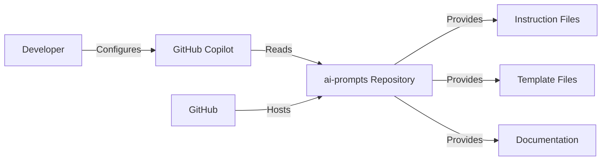
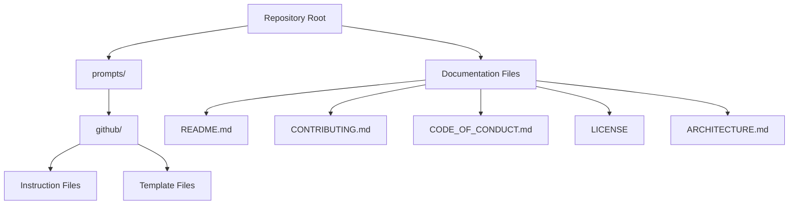
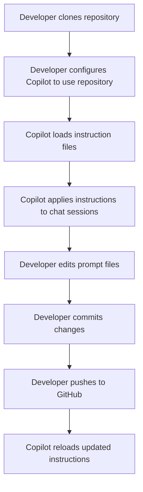
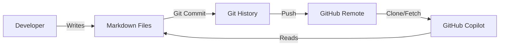
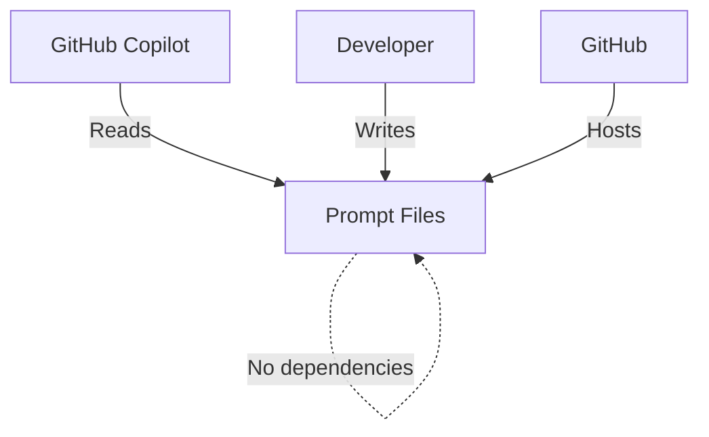

# ai-prompts Architecture

This document describes the current architecture of the ai-prompts repository, a collection of GitHub Copilot prompt files and supporting documentation.

## 📑 Table of Contents

- [Purpose](#purpose)
- [System Context](#system-context)
- [Architectural Style](#architectural-style)
- [Runtime Flow](#runtime-flow)
- [Architectural Areas](#architectural-areas)
- [Data Architecture](#data-architecture)
- [Interfaces and Integrations](#interfaces-and-integrations)
- [Dependency Direction and Rules](#dependency-direction-and-rules)
- [External Dependencies](#external-dependencies)
- [Deployment and Operations](#deployment-and-operations)
- [Compatibility Contracts](#compatibility-contracts)
- [Testing and Verification](#testing-and-verification)
- [Design Constraints](#design-constraints)
- [Related Documentation](#related-documentation)

## 🎯 Purpose

This repository provides a curated collection of prompt files for GitHub Copilot, including instruction files, templates, and supporting documentation. The system's principal responsibility is to organise and version these prompts for use in AI-assisted development workflows. The intended audience is developers configuring GitHub Copilot custom instructions. This document records the repository's structural boundaries and content organisation.

## 🌐 System Context



The principal external boundaries are:
- **GitHub Copilot:** Consumes instruction and prompt files from the repository; ownership external
- **GitHub:** Hosts the repository and provides version control; ownership external
- **Developer:** Authors and maintains prompt content; ownership external

## 🏗️ Architectural Style

The repository follows a **document-centric, flat-hierarchy** style. Content is organised as Markdown files in a shallow directory structure with minimal nesting. This style optimises for discoverability and direct file access by GitHub Copilot's instruction loading mechanism. The principal consequence is that all prompt files are equally accessible at known paths without requiring build, compilation, or packaging steps.



The principal architecture boundaries are:
- **Repository Root:** Contains top-level documentation and configuration; permitted dependencies: none
- **prompts/github/:** Contains GitHub Copilot instruction and template files; permitted dependencies: none
- **Documentation Files:** Standalone Markdown documents; permitted dependencies: none

## 🔄 Runtime Flow



The principal runtime sequence is:
1. Developer clones or updates the repository locally
2. Developer configures GitHub Copilot to reference the repository's instruction files
3. GitHub Copilot loads and applies the instruction files to relevant chat sessions
4. Developer edits prompt files as needed
5. Changes are committed and pushed to GitHub
6. GitHub Copilot reloads updated instructions on next session

## 🗂️ Architectural Areas

### Repository Root Documentation

Paths:
- `README.md`
- `CONTRIBUTING.md`
- `CODE_OF_CONDUCT.md`
- `LICENSE`
- `ARCHITECTURE.md`

Responsibilities:
- Provide project overview and navigation
- Define contribution guidelines
- Establish community standards
- Specify licensing terms
- Document system architecture

Boundary rules:
- Files must be valid Markdown
- Links must be repository-relative and resolvable
- Content must follow British spelling conventions

### GitHub Copilot Prompts

Paths:
- `prompts/github/`

Responsibilities:
- Provide instruction files for GitHub Copilot customisation
- Provide template files for GitHub documentation generation
- Organise prompts by functional domain

Boundary rules:
- Files must use `.md` extension
- Instruction files must follow the instruction file format with YAML frontmatter
- Template files must follow the template format with YAML frontmatter
- No subdirectories beyond `github/` currently exist

## 💾 Data Architecture

The repository stores only Markdown text files. No databases, caches, or binary assets are present. Data flows are unidirectional: files are authored by developers, committed to Git, and read by GitHub Copilot.



| Data or Store | Owner | Representation and Storage | Lifecycle or Consistency |
|---------------|-------|----------------------------|--------------------------|
| `Markdown prompt files` | Developer | UTF-8 text files in Git | Authored, versioned, immutable per commit |
| `Git history` | Git | Git objects | Append-only, cryptographically verified |
| `GitHub remote` | GitHub | Hosted Git repository | Authoritative source, replicated on clone |

## 🔌 Interfaces and Integrations

| Interface or Integration | Direction | Contract | Owner | Failure Semantics |
|--------------------------|-----------|----------|-------|-------------------|
| `GitHub Copilot instruction loading` | Inbound | File paths referenced in Copilot settings | GitHub Copilot | Missing files ignored; malformed frontmatter may cause load failure |
| `Git clone/fetch/push` | Bidirectional | Git protocol | Git/GitHub | Network failure blocks sync; local work preserved |
| `Markdown rendering` | Outbound | CommonMark/GitHub Flavored Markdown | GitHub/GitHub Copilot | Rendering errors non-blocking; raw text displayed |

## 🧭 Dependency Direction and Rules



The principal dependency rules are:
- Prompt files have no internal dependencies on each other
- Prompt files have no external runtime dependencies
- Documentation files may link to prompt files but not vice versa
- All content must be self-contained within each file

## 📦 External Dependencies

| Dependency | Responsibility | Integration Boundary | Architectural Consequence |
|------------|----------------|----------------------|---------------------------|
| `GitHub` | Hosting, version control, access control | Git remote | Repository availability depends on GitHub uptime |
| `GitHub Copilot` | Instruction consumption, application | File system / VS Code settings | Prompt format must match Copilot expectations |
| `Git` | Version control, history, distribution | Local repository | All changes tracked; history immutable |

## 🚀 Deployment and Operations

| Concern | Current Design | Architectural Consequence |
|---------|----------------|---------------------------|
| Process topology | None (static files) | No runtime processes; zero operational overhead |
| Deployment model | Git push to GitHub | Changes live immediately on push; no build step |
| Persistent state | Git history only | Full audit trail; rollback via Git revert |
| Scaling assumptions | N/A | Repository size scales with file count; no performance constraints |
| Startup and shutdown | N/A | No services to start or stop |
| Operator-visible outputs | Git commit log, GitHub file view | Changes visible in Git history and GitHub UI |

## 🛡️ Compatibility Contracts

| Contract | Owner | Invariant | Verification | Change Policy |
|----------|-------|-----------|--------------|---------------|
| `Instruction file frontmatter format` | Developer | YAML frontmatter with `description`, `applyTo` fields | Manual review; Copilot load success | Additive only; existing fields preserved |
| `Template file frontmatter format` | Developer | YAML frontmatter with `description`, `applyTo` fields | Manual review; template engine compatibility | Additive only; existing fields preserved |
| `Repository-relative Markdown links` | Developer | All links resolve to existing files | Manual verification; link checker | Links updated when targets move |
| `British spelling convention` | Developer | All prose uses British spelling | Manual review; spell-check | Consistent application across all files |

## ✅ Testing and Verification

No automated test suite exists. Verification is manual:

- **Instruction loading:** Verify GitHub Copilot loads instruction files without error
- **Template rendering:** Verify template files produce expected output when used
- **Link integrity:** Verify all repository-relative links resolve
- **Spelling:** Verify British spelling conventions followed
- **Frontmatter validity:** Verify YAML frontmatter parses correctly

Execute the principal automated verification with:

```bash
# No automated verification commands exist
# Manual verification steps:
# 1. Open repository in VS Code with GitHub Copilot enabled
# 2. Verify instruction files appear in Copilot chat context
# 3. Check all Markdown links resolve
# 4. Validate YAML frontmatter syntax
```

## ⚠️ Design Constraints

- **Flat hierarchy:** Directory depth limited to two levels (root → prompts/github/) for Copilot discoverability
- **Markdown only:** No code, scripts, or binary assets; content must be human-readable text
- **No build step:** Files consumed directly by Copilot; no compilation, bundling, or transformation
- **GitHub Copilot format compliance:** Instruction and template files must adhere to Copilot's expected frontmatter schema
- **British spelling:** All prose must use British English conventions per language instructions
- **Template fidelity:** GitHub documentation templates (README, CONTRIBUTING, CODE_OF_CONDUCT, etc.) must preserve fixed prose exactly

## 📚 Related Documentation

| Document | Scope |
|----------|-------|
| `README.md` | Project overview, navigation, badges, contribution and engagement guidance |
| `CONTRIBUTING.md` | Contribution guidelines, issue reporting, pull request process |
| `CODE_OF_CONDUCT.md` | Community standards, expected conduct, reporting procedures |
| `LICENSE` | GNU General Public License v3.0 terms |
| `prompts/github/*.md` | Instruction and template files for GitHub Copilot customisation |